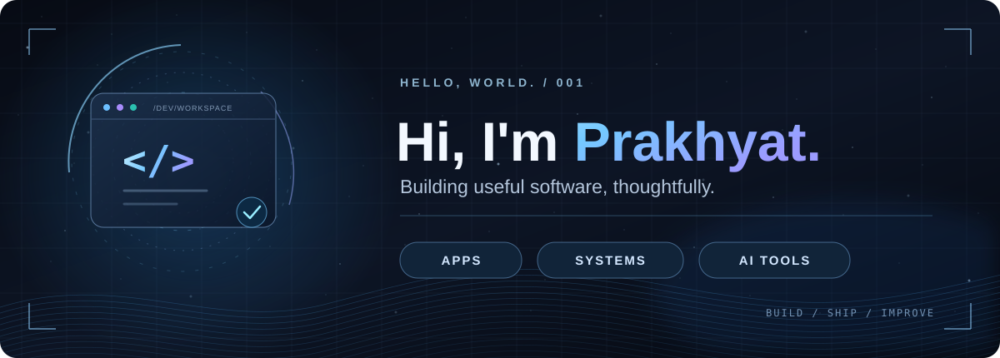
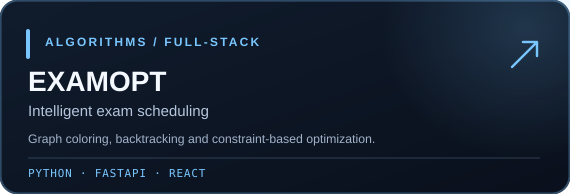
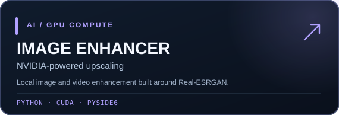
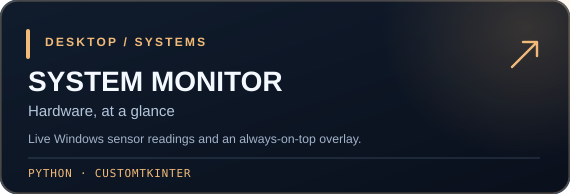
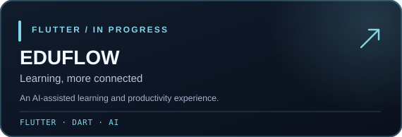

 

**SOFTWARE DEVELOPER** &nbsp; · &nbsp; **BUILDER** &nbsp; · &nbsp; **PROBLEM SOLVER**

 

I turn ideas into useful applications, practical tools, and thoughtful interfaces.  
From full-stack products to GPU utilities, I enjoy making software that works well and feels good to use.

 

&nbsp;

---

### 01 / ABOUT ME

I'm a developer interested in the intersection of **software engineering, product design, and automation**.

I work on projects ranging from exam timetable optimization and mobile applications to NVIDIA-powered image processing and Windows system utilities. I care about clean architecture, practical performance, and making complex things feel simple.

> **Build something useful. Make it intuitive. Keep improving it.**

---

### 02 / TECH STACK

  

Python · Dart · Java · JavaScript / TypeScript · Flutter · React · FastAPI · Supabase · Git · Linux

---

### 03 / SELECTED WORK

---

### 04 / GITHUB ACTIVITY

 

Live activity graphics are provided by community-maintained GitHub services. You can also view <a href="https://github.com/prakhyat798">my native GitHub contributions</a>.

---

### 05 / LEARNING & CREDENTIALS

<b>Verified courses and certificates</b>

 

- [Android 14 & Kotlin Development Masterclass](https://ude.my/UC-31a4f0c4-9719-40de-9166-fd0e38aaa7a1) — Udemy
- [Learn SQL](https://www.boot.dev/certificates/85210c9d-a37c-4fad-aad3-3a7ef1ef9f02) — Boot.dev
- [Learn Linux](https://www.boot.dev/certificates/49d05533-a647-4a81-8f88-bb75c1c0261f) — Boot.dev

 

DESIGN WITH INTENT. ENGINEER WITH PURPOSE.

  

<a href="https://github.com/prakhyat798?tab=repositories">Explore all repositories</a>

