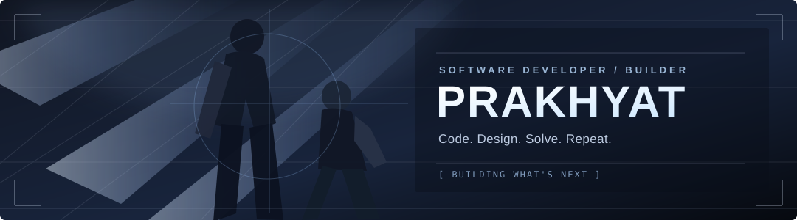
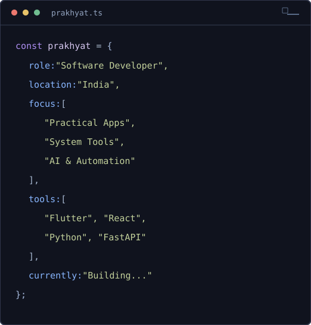

 

### Hi 👋, I'm Prakhyat

**Software Developer · Builder · Problem Solver**

Building practical software with clean design, thoughtful architecture, and a little curiosity.

 

---

### 🎯 About Me

<table>
  <tr>
    <td width="50%" valign="top">
      
    </td>
    <td width="50%" valign="top">
      
    </td>
  </tr>
</table>

I'm **Prakhyat**, a software developer who enjoys turning ideas into polished applications and useful tools. I work across **Flutter, full-stack web apps, automation, and systems utilities**.

I care about writing understandable code, building reliable features, and making complicated things feel easy.

> “The best way to predict the future is to invent it.” — Alan Kay

---

### 🌐 Connect With Me

&nbsp;

&nbsp;

---

### 🛠️ Tech Stack

  

 

---

### 📊 GitHub Analytics

 

 

---

### 🏆 GitHub Trophies

---

### 🚀 Featured Projects

| Project | What it does | Stack |
| :--- | :--- | :--- |
| **[ExamOpt](https://github.com/prakhyat798/ExamOpt)** | Optimizes examination schedules using graph coloring and backtracking | Python, FastAPI, React |
| **[FoodBridge](https://github.com/prakhyat798/food-bridge-)** | Connects surplus-food donors, NGOs and riders | Flutter, Supabase |
| **[Image Enhancer](https://github.com/prakhyat798/Image-Enhancer)** | NVIDIA-accelerated image and video super-resolution | Python, CUDA, Real-ESRGAN |
| **[System Monitor](https://github.com/prakhyat798/System-Monitor)** | Live Windows hardware monitoring and overlay | Python, CustomTkinter |
| **[EduFlow](https://github.com/prakhyat798/eduflow)** | AI-assisted learning and productivity, in progress | Flutter, Dart |

<b>🎓 Certifications</b>

 

- [Android 14 & Kotlin Development Masterclass](https://ude.my/UC-31a4f0c4-9719-40de-9166-fd0e38aaa7a1)
- [Learn SQL — Boot.dev](https://www.boot.dev/certificates/85210c9d-a37c-4fad-aad3-3a7ef1ef9f02)
- [Learn Linux — Boot.dev](https://www.boot.dev/certificates/49d05533-a647-4a81-8f88-bb75c1c0261f)

 

Code · Design · Build · Improve

