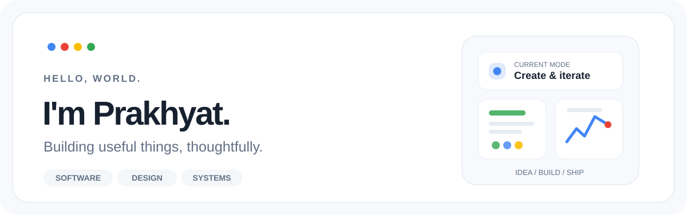

<picture>
  <source media="(prefers-color-scheme: dark)" srcset="./assets/profile-hero-dark.svg">
  <source media="(prefers-color-scheme: light)" srcset="./assets/profile-hero-light.svg">
  
</picture>

 

**Software developer · BCA student · Curious about how things work**

I enjoy building polished apps, solving practical problems, and connecting design with engineering.

[Selected work](#selected-work) &nbsp;·&nbsp; [Toolbox](#toolbox) &nbsp;·&nbsp; [Credentials](#credentials)

 

### Selected work

| Project | What I'm building |
| :--- | :--- |
| **[ExamOpt](https://github.com/prakhyat798/ExamOpt)** | Constraint-based exam timetable optimization using graph coloring, backtracking, FastAPI, and React. |
| **[FoodBridge](https://github.com/prakhyat798/food-bridge-)** | A Flutter + web platform connecting food donors, NGOs, and riders through Supabase. |
| **[Image Enhancer](https://github.com/prakhyat798/Image-Enhancer)** | Local NVIDIA-powered image and video super-resolution, built around Real-ESRGAN. |
| **[System Monitor](https://github.com/prakhyat798/System-Monitor)** | A lightweight Windows hardware dashboard with live sensor readings and an overlay. |

Also exploring: [EduFlow](https://github.com/prakhyat798/eduflow) — an AI-assisted learning and productivity app in progress.

### Toolbox

**Languages** &nbsp; Python · Dart · Java · JavaScript / TypeScript · SQL

**Things I build with** &nbsp; Flutter · React · FastAPI · Supabase · Git · Linux

**I care about** &nbsp; Thoughtful interfaces · Useful automation · Performance · Clear architecture

### Credentials

Verified learning certificates

 

- **[Android 14 & Kotlin Development Masterclass](https://ude.my/UC-31a4f0c4-9719-40de-9166-fd0e38aaa7a1)** — Udemy
- **[Learn SQL](https://www.boot.dev/certificates/85210c9d-a37c-4fad-aad3-3a7ef1ef9f02)** — Boot.dev
- **[Learn Linux](https://www.boot.dev/certificates/49d05533-a647-4a81-8f88-bb75c1c0261f)** — Boot.dev

 

  Less noise. More useful software.
    
  <a href="https://github.com/prakhyat798?tab=repositories">Explore all repositories</a>

